# Irish Global Logistics
### Azure Data Engineering | Databricks Lakehouse | DataOps

An end-to-end Azure data platform demonstrating incremental ingestion, a Databricks medallion lakehouse, data quality, change data capture, and deployment across development and production environments.

**Focus:** End-to-end data engineering · **Architecture:** Lakehouse · **Cloud:** Microsoft Azure

---

## Project overview

This project builds a data platform for a fictional Irish logistics business. Operational data is extracted from Azure SQL Database, while driver working-hours information arrives as employee-uploaded CSV files. Azure Data Factory moves both data sources into Azure Data Lake Storage Gen2, where Azure Databricks processes the data through Bronze, Silver and Gold layers.

The aim was to build a practical end-to-end engineering solution: ingest data incrementally, retain traceability in the lakehouse, apply data-quality controls, manage changes to source records, and publish curated datasets for operational reporting. Databricks Asset Bundles provide repeatable deployment across separate development and production catalogs.

### Platform components

| Platform area | Technology / approach |
|---|---|
| Source systems | Azure SQL Database and employee-uploaded CSV files |
| Ingestion | Azure Data Factory |
| Data lake | Azure Data Lake Storage Gen2 |
| Processing | Azure Databricks, PySpark and Delta Lake |
| File ingestion | Databricks Auto Loader |
| Data architecture | Bronze → Silver → Gold |
| Data quality | Expectations, validation, quarantine and deduplication |
| Change processing | Auto CDC / SCD Type 1 for applicable Silver datasets |
| Governance | Unity Catalog |
| Deployment and orchestration | Databricks Asset Bundles |

## Architecture

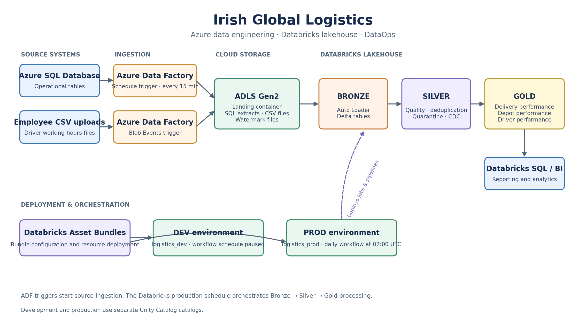  

**Two ingestion paths**
- **Azure SQL:** ADF extracts changed records from four operational tables using per-table watermarks.
- **Employee files:** ADF moves uploaded driver working-hours CSV files from a separate Blob Storage container into ADLS Gen2.

**Processing flow**
- Auto Loader incrementally ingests landed files into Bronze Delta tables.
- Silver applies data quality rules, deduplication, quarantine and configured CDC processing.
- Three independent Gold pipelines publish datasets for delivery, depot and driver performance.

---

## 1. Azure Data Factory

### Incremental Azure SQL ingestion

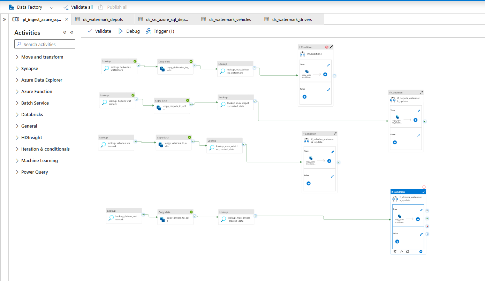

*Four source-table branches use the same watermark-based ingestion pattern.*

**Pipeline:** `pl_ingest_azure_sql_to_adls_global_logistics_dev`

The pipeline uses a watermark-based incremental loading pattern. Each source table maintains its own watermark in ADLS Gen2, allowing ADF to identify records modified since the previous extraction. This avoids repeatedly extracting the full source tables.

For each source table, the pipeline:

1. Reads the existing watermark from ADLS Gen2.
2. Extracts rows modified after that watermark.
3. Writes the extracted records to a timestamped CSV file.
4. Looks up the maximum modification timestamp.
5. Updates the watermark only when a new maximum timestamp is available.

**Example: deliveries source query**

```sql
SELECT *
FROM dbo.deliveries
WHERE modified_date > '@{activity('lookup_deliveries_watermark').output.firstRow.Prop_0}'
```

**Timestamped output filename**

```text
@concat('deliveries_', formatDateTime(utcNow(), 'yyyyMMdd_HHmmss'), '.csv')
```

**Watermark update condition**

```text
@not(empty(activity('lookup_max_deliveries_watermark').output.firstRow.max_modified_date))
```

The pipeline uses a separate watermark for each source table. This means each branch can track its own progress and extract only records modified since its previous watermark, rather than repeatedly copying the full table.

The watermark lookup reads the current value from ADLS Gen2 before the source query runs:

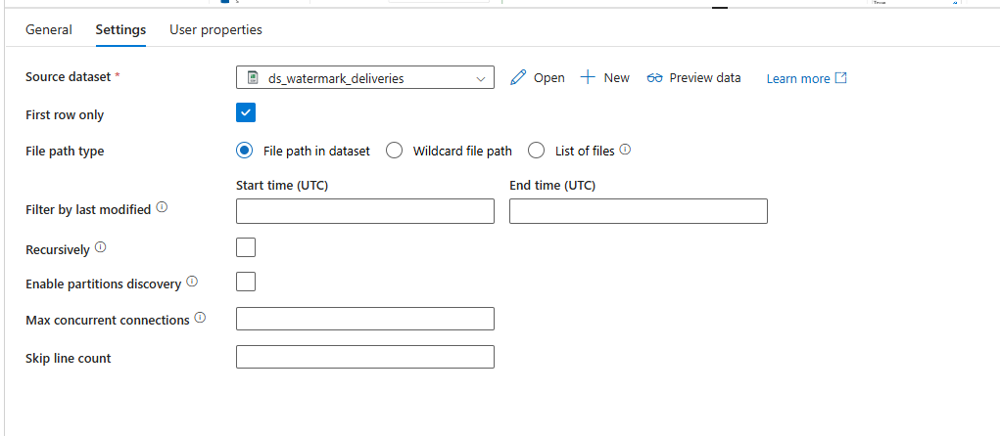

*Lookup activity configured to read the existing watermark.*


*Dataset configuration for the watermark file stored in ADLS Gen2.*

The Copy activity uses the retrieved value in its SQL query and writes the changed records to a timestamped CSV file:


*The source query filters deliveries using the previous watermark.*

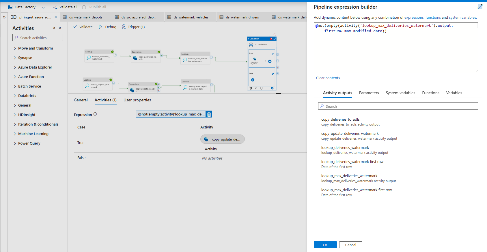


*The sink writes CSV output using a timestamped filename.*

After extraction, ADF retrieves the maximum modification timestamp from the source. The watermark is updated only when a new maximum value is returned, avoiding an update when the extraction has no newer records:


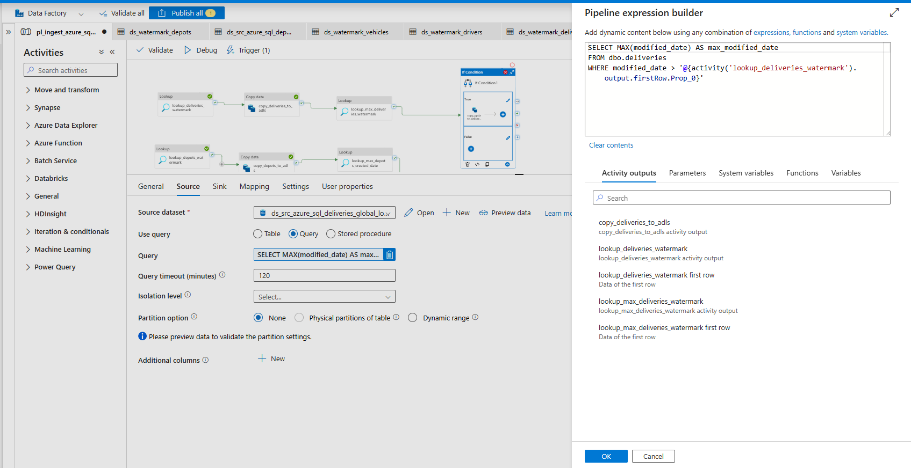

### Employee working-hours files

Driver working-hours data follows a separate file-based ingestion path. Employees upload CSV files to the `employee-uploads` Blob Storage container, and ADF copies those files into ADLS Gen2 for Bronze ingestion.

**Pipeline:** `pl_ingest_employee_working_hours`

- Source dataset: `ds_blob_driver_working_hours`.
- Source uses a wildcard file path with the `*.csv` file filter to select CSV uploads.
- Copy activity: `copy_driver_working_hours_to_adls`.
- Sink dataset: `ds_adls_driver_working_hours`.
- Copy behaviour: **Merge files**.
- The sink filename is generated dynamically using a timestamp, for example `driver_working_hours_yyyyMMdd_HHmmss.csv`.
- The landed CSV is ingested by the Bronze working-hours notebook.

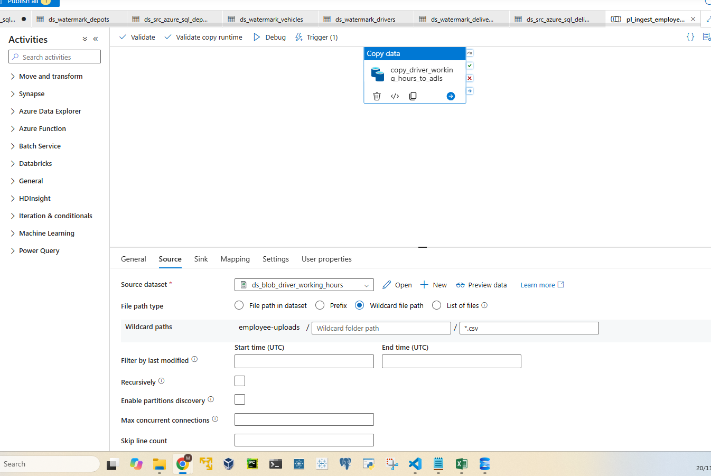

*Blob Storage source configuration, including the wildcard CSV file filter.*

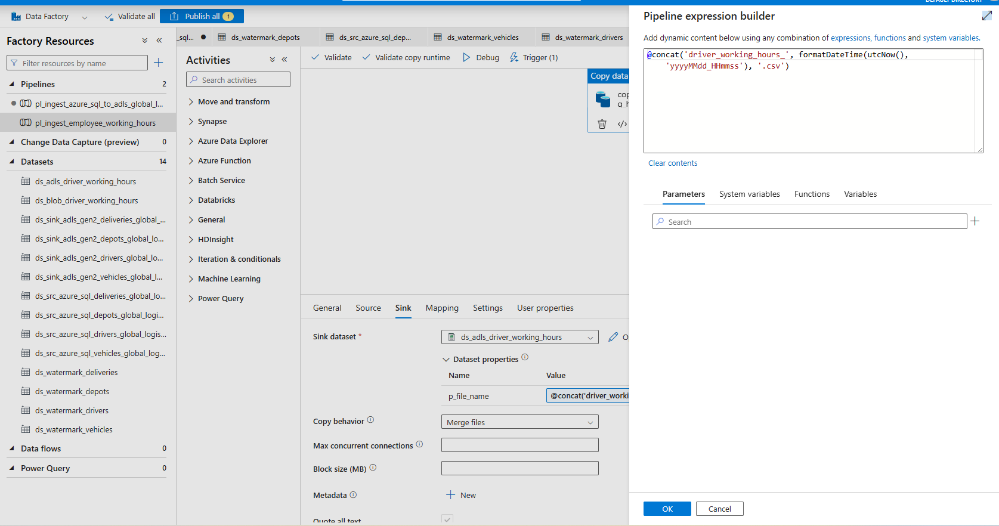

*ADLS Gen2 sink configuration using Merge files and a parameterised filename.*

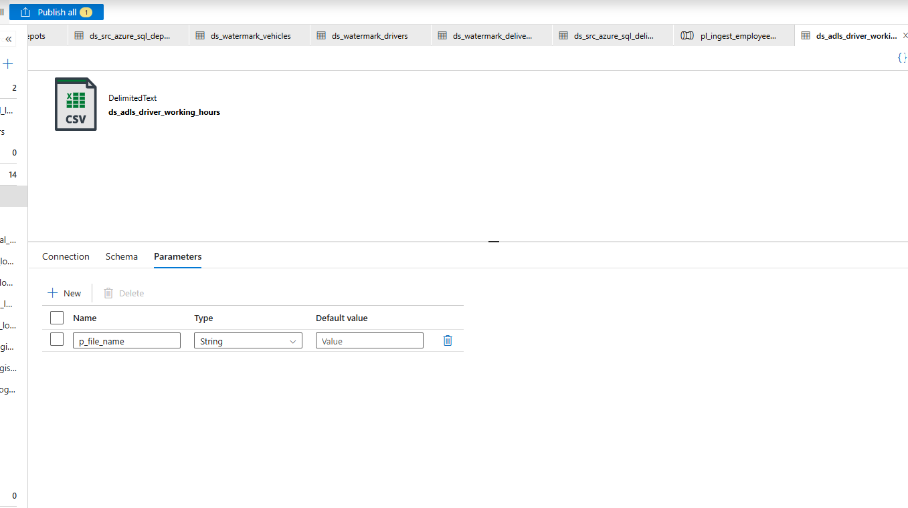

*The sink dataset exposes `p_file_name` as a string parameter used by the pipeline.*

### ADF triggers

Azure Data Factory has two configured trigger types for the ingestion paths. These triggers are separate from the Databricks workflow schedule described later: ADF initiates source ingestion, while Databricks orchestration runs the lakehouse processing workflow.

**Azure SQL — schedule trigger**

`trg_azure_sql_ingestion_schedule` is a `ScheduleTrigger` configured to run the Azure SQL ingestion pipeline every **15 minutes**. Its configured time zone is Abu Dhabi / Muscat (UTC+4).

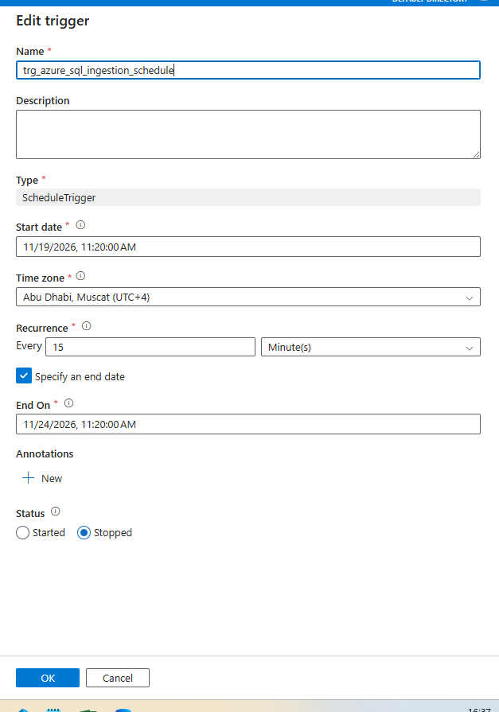

*Schedule trigger configuration showing its 15-minute recurrence and UTC+4 time zone.*

**Employee uploads — Blob events trigger**

`trg_employee_file_upload` is a `BlobEventsTrigger` configured through the Azure subscription. It provides an event-driven entry point for the employee file-upload pipeline, so the ingestion path can respond to Blob Storage events rather than relying on a polling schedule.

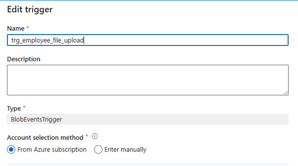

*Blob Events trigger configuration for the employee-upload ingestion path.*

---

## 2. ADLS Gen2

**Storage account:** `stgloballogisticsdev`

ADLS Gen2 is the central landing layer between ingestion and Databricks processing. It stores the Azure SQL extracts, employee-uploaded files and watermark files in separate paths. The Bronze pipelines use these landed files as their ingestion source.

| Container | Purpose |
|---|---|
| `landing` | Source extracts, employee files and watermark files |
| `databricks` | Databricks-related storage locations |

Key landing paths:

```text
landing/
├── azure_sql/
│   └── deliveries/
├── deliveries/
├── depots/
├── drivers/
├── vehicles/
├── driver_working_hours/
└── watermarks/
    ├── deliveries_watermark.txt
    ├── depots_watermark.txt
    ├── drivers_watermark.txt
    └── vehicles_watermark.txt
```

---

## 3. Databricks lakehouse

Unity Catalog provides separate development and production catalogs.

| Environment | Catalog | Schemas |
|---|---|---|
| DEV | `logistics_dev` | `bronze`, `silver`, `gold` |
| PROD | `logistics_prod` | `bronze`, `silver`, `gold` |

### Bronze — incremental ingestion

Bronze ingestion uses Databricks Auto Loader to incrementally discover new files arriving in ADLS Gen2. Checkpoints maintain processing state between runs, allowing ingestion to continue from previously processed files rather than starting again from the beginning.

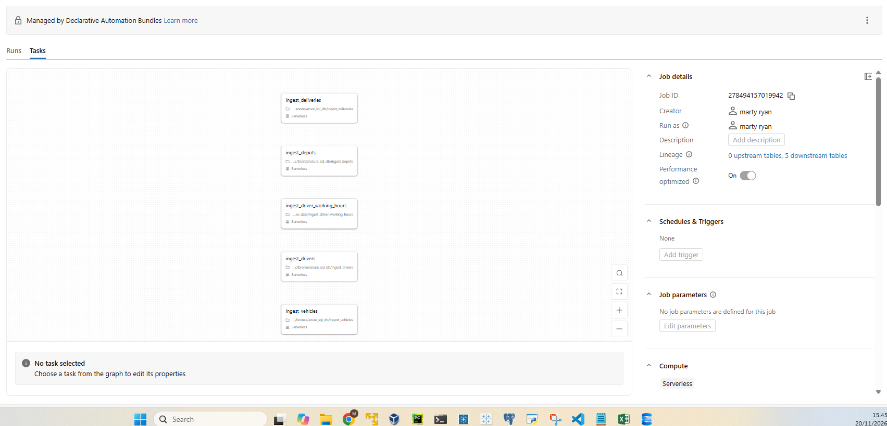

*Five ingestion tasks are managed through Databricks Asset Bundles.*

**Ingestion notebooks**
- `ingest_deliveries`
- `ingest_depots`
- `ingest_drivers`
- `ingest_vehicles`
- `ingest_driver_working_hours`

**Implementation**
- Shared ingestion helper: `src/05_utils/bronze_ingestion.py`.
- Auto Loader (`cloudFiles`) for incremental file discovery.
- Explicit schemas and schema tracking.
- Checkpoints to track processed files.
- Rescue mode for unexpected data in `_rescued_data`.
- Ingestion metadata: `_ingestion_timestamp` and `_metadata.file_path`.
- `availableNow` trigger for bounded processing.
- Delta tables as the Bronze storage format.


*Bronze job execution history showing successful runs.*

### Silver — data quality and CDC

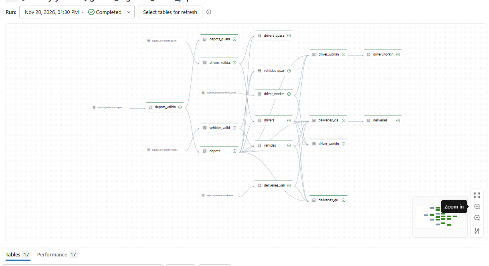

*Silver pipeline lineage across the source and transformed datasets.*

**Processing**
- Validation using `@dp.expect` and `@dp.expect_all`.
- Separate clean, validated and quarantine outputs.
- Deduplication using business keys and window functions.
- Latest-record selection using ingestion timestamps and source-file ordering.
- Referential-integrity checks, including vehicle-to-depot validation.
- Auto CDC / SCD Type 1 for applicable datasets, including deliveries and driver working-hours data.

**Example quarantine reason codes**
- `MISSING_DEPOT_ID`
- `MISSING_DEPOT_NAME`
- `MISSING_CITY`
- `MISSING_COUNTY`
- `DUPLICATE_DEPOT_ID`


*Silver pipeline results show clean, validated and quarantine datasets.*

### Gold — reporting datasets

Three independent Gold pipelines publish reporting-ready materialized views. Each can be refreshed separately after Silver processing.

#### Delivery performance

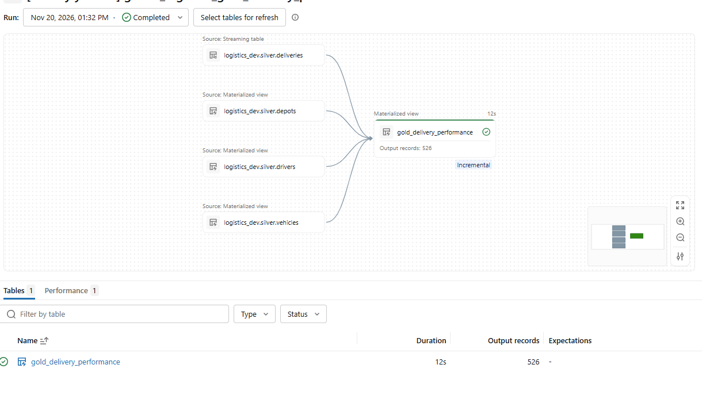

**`gold_delivery_performance`**
- Joins deliveries with depots, drivers and vehicles.
- Derives delivery year, month, day and month-year fields.
- Creates success, failure, completed, delayed, in-transit and pending flags.
- Does not infer delivery duration from `modified_date`.


*Recorded output: 526 rows · Incremental processing.*

#### Depot performance


**`gold_depot_performance`**
- Monthly depot workload.
- Delivery volumes by depot.
- Delivery failure analysis.
- Combines delivery, depot and driver working-hours information.

*Recorded output: 55 rows.*

#### Driver performance

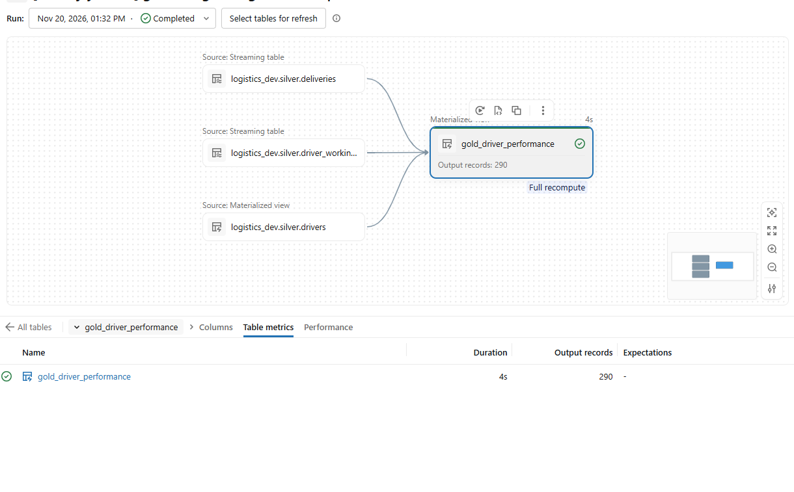

**`gold_driver_performance`**
- Driver-level operational reporting.
- Delivery outcomes alongside working-hours information.
- Combines deliveries, drivers and driver working-hours data.

*Recorded output: 290 rows.*

---

## 4. Deployment and orchestration

The Databricks Asset Bundle is named `global_logistics`. Resource definitions are maintained in the `resources/` directory and included by `databricks.yml`.

### DEV and PROD targets

| Setting | DEV | PROD |
|---|---|---|
| Bundle target | `dev` | `prod` |
| Deployment mode | Development | Production |
| Unity Catalog | `logistics_dev` | `logistics_prod` |
| Workflow schedule | Paused | Daily at 02:00 UTC |
| Default target | Yes | No |

The `${var.catalog}` variable passes the selected catalog into the deployed jobs and pipelines.

### End-to-end workflow

The production Databricks workflow is scheduled to run daily at **02:00 UTC**. The DEV target keeps its schedule paused so development runs can be controlled separately. This Databricks schedule is independent of the Azure Data Factory triggers described earlier: ADF starts source ingestion, while the Databricks schedule orchestrates lakehouse processing.

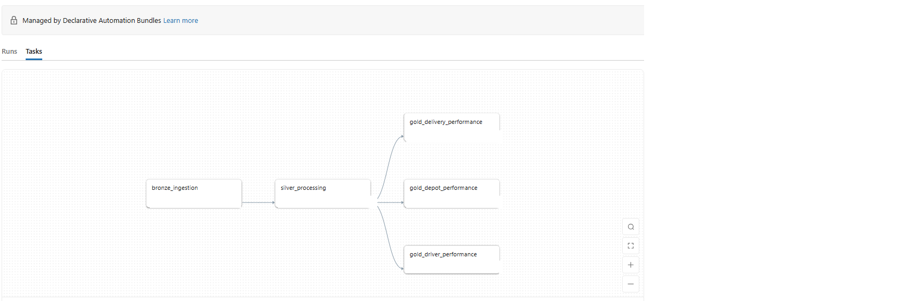

The `global_logistics_full_workflow` contains five tasks:

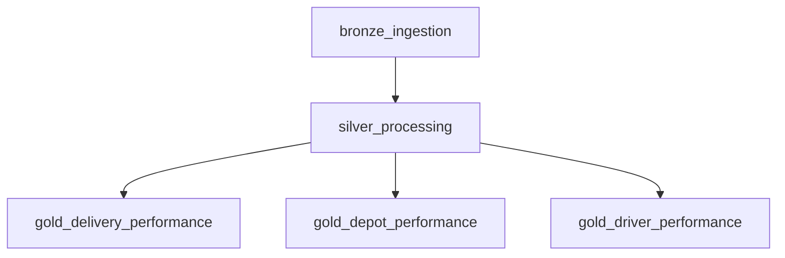

- Bronze runs first.
- Silver depends on Bronze.
- All three Gold pipelines depend on Silver.
- Gold tasks run independently after Silver.


*Production workflow configuration and task dependencies.*

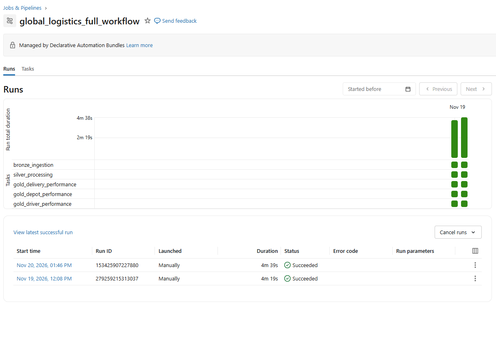

*The displayed production execution completed all five tasks successfully in 4 minutes 39 seconds.*

### Databricks CLI and bundle deployment

**CLI version:** `1.21.0`  
**Authentication profile:** `LOGISTICS_DEV`

Verify the CLI and authentication:

```powershell
databricks --version
databricks auth profiles
databricks current-user me --profile LOGISTICS_DEV
```

Validate and deploy DEV:

```powershell
databricks bundle validate -t dev
databricks bundle deploy -t dev
```

Run the workflow:

```powershell
databricks bundle run global_logistics_full_workflow -t dev
```

Validate and deploy PROD when performing a controlled production release:

```powershell
databricks bundle validate -t prod
databricks bundle deploy -t prod
```

**Recorded DEV deployment result**

```text
Validation OK!

Files: 4 uploaded, 10 deleted
Resources: 0 created, 2 changed, 0 deleted, 4 unchanged
```

The updated resources were the Gold driver-performance pipeline and the orchestration job.

---

## 5. Execution results

| Component | Recorded result |
|---|---|
| ADF incremental ingestion | 20 activities succeeded |
| Bronze | Successful job executions |
| Silver | Completed run; 17 pipeline tables |
| Gold delivery | 526 output rows |
| Gold depot | 55 output rows |
| Gold driver | 290 output rows |
| PROD orchestration | Five tasks succeeded |
| DEV bundle deployment | Validation and deployment succeeded |

*Row counts and durations are observations from recorded runs, not fixed expectations.*

---

## Repository structure

```text
global_logistics/
├── databricks.yml
├── README.md
├── .gitignore
├── resources/
│   ├── bronze_job.job.yml
│   ├── silver_pipeline.pipeline.yml
│   ├── gold_delivery_performance.pipeline.yml
│   ├── gold_depot_performance.pipeline.yml
│   ├── gold_driver_performance.pipeline.yml
│   └── orchestration_job.job.yml
├── src/
│   ├── 05_utils/
│   ├── bronze/
│   │   ├── azure_sql_db/
│   │   └── employee_data/
│   ├── silver/
│   │   └── transformations/
│   └── gold/
└── screenshots/
    ├── adf/
    ├── architecture/
    ├── databricks/
    └── orchestration/
```

## Security and configuration

- Keep PATs, passwords, connection strings and `.env` files out of source control.
- Use `logistics_dev` for development and reserve `logistics_prod` for controlled production deployments.

## Repository

[View the project on GitHub](https://github.com/MJRML/Irish-Global-Logistics-Azure-Data-Engineering-Databricks-Lakehouse-and-BI-Platform)
