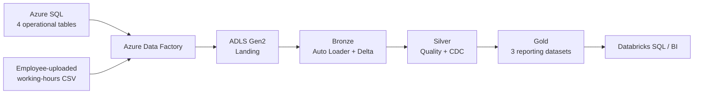
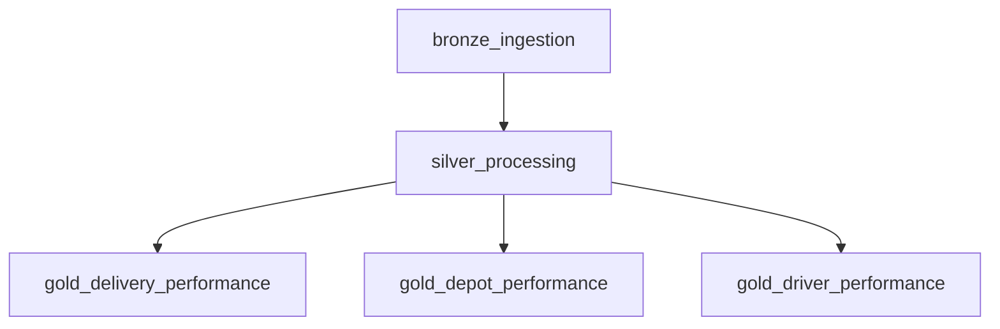

# Irish Global Logistics

### Azure Data Engineering · Databricks Lakehouse · DataOps

An end-to-end data platform built with Azure Data Factory, ADLS Gen2 and
Azure Databricks. The project demonstrates incremental ingestion,
medallion architecture, data quality, CDC, environment-aware deployment
and orchestration using Databricks Asset Bundles.

**Project type:** Portfolio project · **Data:** Synthetic · **Cloud:**
Microsoft Azure

------------------------------------------------------------------------

## At a glance

  -----------------------------------------------------------------------
  Area                                Implementation
  ----------------------------------- -----------------------------------
  Source ingestion                    Azure SQL Database and
                                      employee-uploaded CSV files

  Ingestion orchestration             Azure Data Factory

  Data lake                           Azure Data Lake Storage Gen2

  Processing                          Azure Databricks, PySpark and Delta
                                      Lake

  Ingestion pattern                   ADF watermark-based extraction and
                                      Databricks Auto Loader

  Data architecture                   Bronze → Silver → Gold

  Data quality                        Expectations, validation,
                                      quarantine and deduplication

  Change processing                   Auto CDC / SCD Type 1 for
                                      applicable Silver datasets

  Deployment                          Databricks Asset Bundles

  Governance                          Unity Catalog with separate DEV and
                                      PROD catalogs
  -----------------------------------------------------------------------

------------------------------------------------------------------------

## Architecture



### Data flow

-   **Azure SQL path:** ADF extracts changed rows from `depots`,
    `vehicles`, `drivers` and `deliveries` using per-table watermarks.
-   **Employee-file path:** ADF moves uploaded driver working-hours CSV
    files from a separate Blob Storage container into ADLS Gen2.
-   **Databricks:** Auto Loader incrementally discovers landed files and
    writes Bronze Delta tables.
-   **Silver:** validates, deduplicates, quarantines invalid records and
    applies Auto CDC where configured.
-   **Gold:** publishes three separate performance datasets for
    reporting.

------------------------------------------------------------------------

## Azure Data Factory

### Incremental Azure SQL ingestion

```{=html}
<figure>
```
``{=html}
```{=html}
<figcaption>
```
`<strong>`{=html}ADF pipeline:`</strong>`{=html} four independent
source-table branches use a common watermark-based ingestion pattern.
```{=html}
</figcaption>
```
```{=html}
</figure>
```
The pipeline `pl_ingest_azure_sql_to_adls_global_logistics_dev` applies
the following pattern to each Azure SQL source table:

1.  Read the existing watermark from ADLS Gen2.
2.  Query the source for records modified after that watermark.
3.  Write the extracted records to a timestamped CSV file.
4.  Look up the maximum modification timestamp for the extracted range.
5.  Update the watermark only when a new maximum timestamp is available.

**Deliveries example --- incremental query**

``` sql
SELECT *
FROM dbo.deliveries
WHERE modified_date > '@{activity('lookup_deliveries_watermark').output.firstRow.Prop_0}'
```

**Dynamic output filename**

``` text
@concat('deliveries_', formatDateTime(utcNow(), 'yyyyMMdd_HHmmss'), '.csv')
```

**Conditional watermark update**

``` text
@not(empty(activity('lookup_max_deliveries_watermark').output.firstRow.max_modified_date))
```

### ADF implementation evidence

  ---------------------------------------------------------------------------
  Screenshot                              What it demonstrates
  --------------------------------------- -----------------------------------
  `incremental_ingestion_pipeline.png`    Four source branches in the ADF
                                          pipeline

  `watermark_lookup_settings.png`         Reading the current watermark

  `deliveries_copy_source_settings.png`   SQL query-based source extraction

  `deliveries_copy_sink_settings.png`     CSV sink configuration

  `deliveries_copy_file_naming.png`       Timestamped output filename

  `max_watermark_lookup.png`              Retrieving the maximum source
                                          timestamp

  `watermark_if_condition.png`            Guarding the watermark update

  `watermark_update_copy_activity.png`    Watermark update activity
  ---------------------------------------------------------------------------

### Employee working-hours ingestion

-   Separate employee-upload Blob Storage input.
-   ADF Copy Data activity: `copy_driver_working_hours_to_adls`.
-   Sink copy behaviour: **Merge files**.
-   Landed CSV files are subsequently ingested by the Bronze
    working-hours notebook.

------------------------------------------------------------------------

## ADLS Gen2

Storage account: `stgloballogisticsdev`

Containers: - `landing` --- source extracts, employee files and
watermark files. - `databricks` --- Databricks-related storage
locations.

Key landing paths:

``` text
landing/
├── azure_sql/
│   └── deliveries/
├── deliveries/
├── depots/
├── drivers/
├── vehicles/
├── driver_working_hours/
└── watermarks/
    ├── deliveries_watermark.txt
    ├── depots_watermark.txt
    ├── drivers_watermark.txt
    └── vehicles_watermark.txt
```

------------------------------------------------------------------------

## Databricks lakehouse

Unity Catalog separates the environments:

  Environment   Catalog            Schemas
  ------------- ------------------ ----------------------------
  Development   `logistics_dev`    `bronze`, `silver`, `gold`
  Production    `logistics_prod`   `bronze`, `silver`, `gold`

### Bronze --- incremental file ingestion

```{=html}
<figure>
```
``{=html}
```{=html}
<figcaption>
```
`<strong>`{=html}Bronze ingestion job:`</strong>`{=html} five
independent ingestion tasks, managed through Databricks Asset Bundles.
```{=html}
</figcaption>
```
```{=html}
</figure>
```
Five ingestion notebooks:

-   `ingest_deliveries`
-   `ingest_depots`
-   `ingest_drivers`
-   `ingest_vehicles`
-   `ingest_driver_working_hours`

Implementation highlights:

-   Shared helper: `src/05_utils/bronze_ingestion.py`.
-   Databricks Auto Loader (`cloudFiles`) for incremental file
    discovery.
-   Explicit schemas and schema tracking.
-   Checkpoints for incremental processing.
-   `schemaEvolutionMode = rescue` to retain unexpected data in
    `_rescued_data`.
-   Ingestion metadata, including `_ingestion_timestamp` and
    `_metadata.file_path`.
-   `availableNow` trigger for bounded processing of newly available
    files.
-   Delta tables as the Bronze storage format.

```{=html}
<figure>
```
``{=html}
```{=html}
<figcaption>
```
Recorded Bronze job runs completed successfully.
```{=html}
</figcaption>
```
```{=html}
</figure>
```
### Silver --- quality, quarantine and CDC

```{=html}
<figure>
```
``{=html}
```{=html}
<figcaption>
```
`<strong>`{=html}Silver execution:`</strong>`{=html} validated, clean
and quarantine outputs are visible in the pipeline results.
```{=html}
</figcaption>
```
```{=html}
</figure>
```
The Silver pipeline uses the Databricks Python pipelines API and
materialized views.

**Processing capabilities**

-   Required-field validation using `@dp.expect` and `@dp.expect_all`.
-   Separate clean, validated and quarantine outputs.
-   Quarantine reason codes, including:
    -   `MISSING_DEPOT_ID`
    -   `MISSING_DEPOT_NAME`
    -   `MISSING_CITY`
    -   `MISSING_COUNTY`
    -   `DUPLICATE_DEPOT_ID`
-   Deduplication using business keys and window functions.
-   Latest-record selection using `_ingestion_timestamp` and source-file
    ordering.
-   Referential-integrity checks, including vehicle-to-depot validation.
-   Auto CDC / SCD Type 1 for applicable datasets, including deliveries
    and driver working-hours data.

```{=html}
<figure>
```
``{=html}
```{=html}
<figcaption>
```
Silver pipeline lineage and successful execution.
```{=html}
</figcaption>
```
```{=html}
</figure>
```
### Gold --- reporting datasets

Three independent Gold pipelines publish reporting-ready datasets. Each
can be refreshed separately after Silver processing.

#### Delivery performance

```{=html}
<figure>
```
``{=html}
```{=html}
<figcaption>
```
Delivery performance combines Silver deliveries, depots, drivers and
vehicles.
```{=html}
</figcaption>
```
```{=html}
</figure>
```
`gold_delivery_performance`

-   Joins delivery records to depot, driver and vehicle information.
-   Derives delivery year, month, day and month-year reporting fields.
-   Creates success, failure, completed, delayed, in-transit and pending
    flags.
-   Does not infer delivery duration from `modified_date`.

```{=html}
<figure>
```
``{=html}
```{=html}
<figcaption>
```
Recorded output: 526 rows; incremental processing.
```{=html}
</figcaption>
```
```{=html}
</figure>
```
#### Depot performance

```{=html}
<figure>
```
``{=html}
```{=html}
<figcaption>
```
`<strong>`{=html}`gold_depot_performance``</strong>`{=html} --- combines
delivery, depot and driver working-hours information. Recorded output:
55 rows.
```{=html}
</figcaption>
```
```{=html}
</figure>
```
-   Monthly depot workload.
-   Delivery volumes by depot.
-   Delivery failure analysis.

#### Driver performance

```{=html}
<figure>
```
``{=html}
```{=html}
<figcaption>
```
`<strong>`{=html}`gold_driver_performance``</strong>`{=html} ---
combines deliveries, driver working-hours and driver information.
Recorded output: 290 rows.
```{=html}
</figcaption>
```
```{=html}
</figure>
```
-   Driver-level operational reporting.
-   Delivery outcomes alongside working-hours information.

------------------------------------------------------------------------

## Databricks Asset Bundles and orchestration

The bundle is named `global_logistics`. Resource definitions are
maintained separately under `resources/` and included by
`databricks.yml`.

### Environment configuration

  Configuration            DEV               PROD
  ------------------------ ----------------- ------------------
  Bundle target            `dev`             `prod`
  Deployment mode          Development       Production
  Catalog                  `logistics_dev`   `logistics_prod`
  Orchestration schedule   Paused            Enabled
  Default target           Yes               No

The catalog is passed into jobs and pipelines through `${var.catalog}`.
The same source-controlled definitions can therefore be deployed to
either catalog.

### Orchestration workflow

```{=html}
<figure>
```
``{=html}
```{=html}
<figcaption>
```
DEV workflow dependency structure.
```{=html}
</figcaption>
```
```{=html}
</figure>
```
The workflow `global_logistics_full_workflow` contains five tasks:



-   Bronze runs first.
-   Silver depends on successful Bronze completion.
-   All three Gold pipelines depend on Silver.
-   Gold tasks are independent of one another.
-   Production schedule: daily at **02:00 UTC**.
-   DEV schedule: paused.

### Production execution evidence

```{=html}
<figure>
```
``{=html}
```{=html}
<figcaption>
```
Production workflow history showing successful end-to-end executions.
```{=html}
</figcaption>
```
```{=html}
</figure>
```
The latest displayed production execution completed all five tasks
successfully in **4 minutes 39 seconds**.

------------------------------------------------------------------------

## Deployment

### Prerequisites

-   Azure Databricks workspace access.
-   Databricks CLI.
-   A configured authentication profile.
-   Access to the project's Azure resources and Unity Catalog catalogs.

The project was configured with **Databricks CLI v1.21.0** and the local
profile `LOGISTICS_DEV`.

### Verify the CLI and authentication

``` powershell
databricks --version
databricks auth profiles
databricks current-user me --profile LOGISTICS_DEV
```

### Validate and deploy DEV

Run from the directory containing `databricks.yml`:

``` powershell
databricks bundle validate -t dev
databricks bundle deploy -t dev
```

Run the workflow:

``` powershell
databricks bundle run global_logistics_full_workflow -t dev
```

### Validate and deploy PROD

Production deployment is a controlled release operation:

``` powershell
databricks bundle validate -t prod
databricks bundle deploy -t prod
```

The production target uses `logistics_prod` and enables the daily
orchestration schedule. Do not run production deployment commands as
part of routine development testing.

### Recorded DEV deployment

A successful DEV deployment reported:

``` text
Files: 4 uploaded, 10 deleted
Resources: 0 created, 2 changed, 0 deleted, 4 unchanged
```

The updated resources were the Gold driver-performance pipeline and the
orchestration job.

------------------------------------------------------------------------

## Validation results

  -----------------------------------------------------------------------
  Component                           Recorded evidence
  ----------------------------------- -----------------------------------
  ADF incremental ingestion           Test run succeeded; 20 activities
                                      succeeded

  Bronze                              Successful job executions

  Silver                              Completed pipeline run; 17 tables
                                      in the pipeline

  Gold delivery                       526 output rows

  Gold depot                          55 output rows

  Gold driver                         290 output rows

  Production orchestration            All five tasks succeeded in the
                                      latest displayed run

  DAB DEV deployment                  Validation OK; deployment completed
  -----------------------------------------------------------------------

Output counts and execution durations are observations from recorded
runs, not fixed expectations.

------------------------------------------------------------------------

## Repository structure

``` text
global_logistics/
├── databricks.yml
├── README.md
├── .gitignore
├── resources/
│   ├── bronze_job.job.yml
│   ├── silver_pipeline.pipeline.yml
│   ├── gold_delivery_performance.pipeline.yml
│   ├── gold_depot_performance.pipeline.yml
│   ├── gold_driver_performance.pipeline.yml
│   └── orchestration_job.job.yml
├── src/
│   ├── 05_utils/
│   ├── bronze/
│   │   ├── azure_sql_db/
│   │   └── employee_data/
│   ├── silver/
│   │   └── transformations/
│   └── gold/
└── screenshots/
    ├── adf/
    ├── architecture/
    ├── databricks/
    └── orchestration/
```

------------------------------------------------------------------------

## Security notes

-   No PATs, passwords, connection strings or `.env` files belong in
    source control.
-   Use the DEV catalog for development and the PROD catalog only for
    controlled production deployment.
-   Keep personal workspace paths and account identifiers out of public
    screenshots and documentation.
-   The project uses synthetic portfolio data.

------------------------------------------------------------------------

## Repository

[View the project on
GitHub](https://github.com/MJRML/Irish-Global-Logistics-Azure-Data-Engineering-Databricks-Lakehouse-and-BI-Platform)
